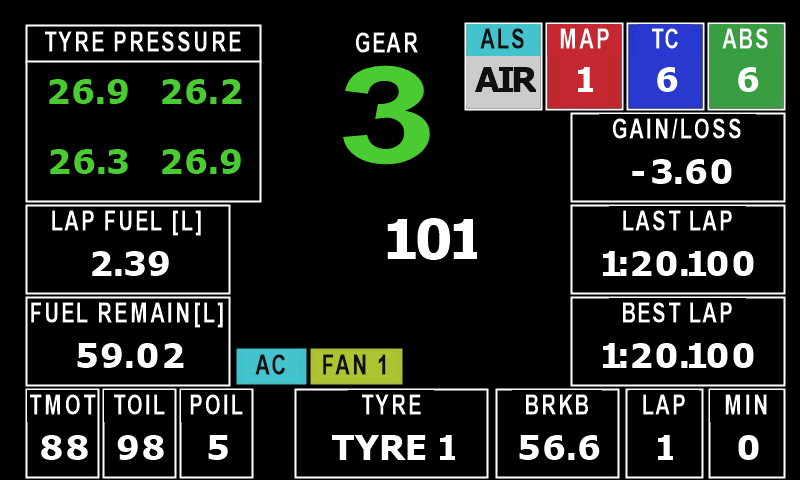
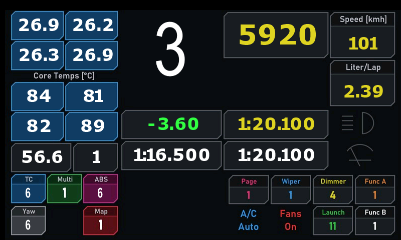
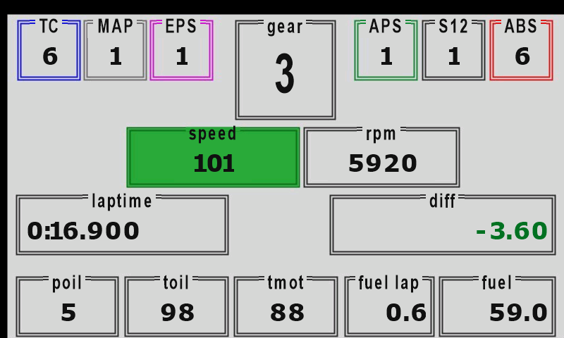
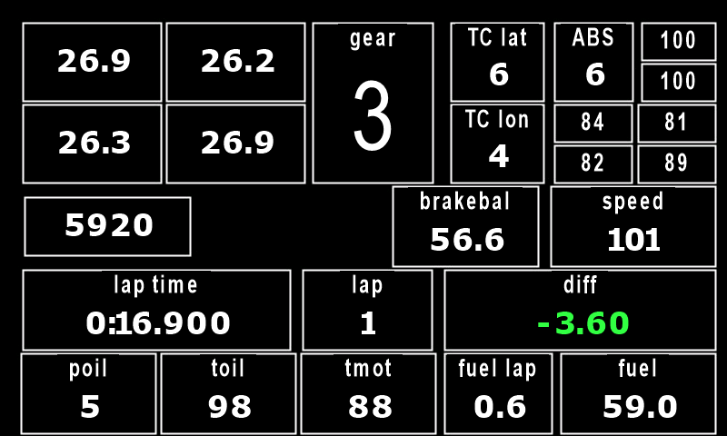
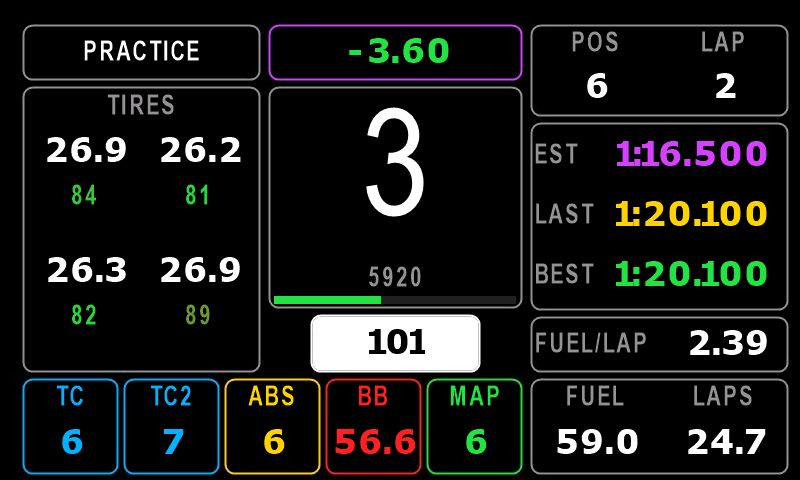

# FX Unleashed dashes

Dashes for the **Simagic FX Pro**'s 800x480 screen, for the [FX Unleashed](https://github.com/fxunleashed/fx-unleashed)
SimHub plugin (and its enhanced edition, FX Unleashed Enhanced), in Unleashed (USB) mode, plus the tools used to make,
check and measure them.

- **iRacing GT3 replicas**: what each car shows on its own display, one dash per car, from iRacing's manuals and from
  frames of the sim.
- **A default dash** for every other car and game, laid out after the Lovely Dashboard's main screen.
- **Tools**: generators for the dashes, the plugin's four checks through its local API, converting LMU dashes for iRacing,
  and recording the sim's shift lights frame by frame.

> An independent project, not affiliated with Simagic, FX Unleashed, Lovely Sim Racing or iRacing. Simagic, FX Pro,
> iRacing and the car makers' names are trademarks of their owners, used only to say what the dashes are for.

## The dashes

All are drawn from scratch with the screen's own shapes and text (the Corvette's panels are a picture drawn by its
generator). Each passed the plugin's four checks: layout (`check`), text bands (`fit-bands`), screen traffic (`verify`)
and `render`.

| | |
|---|---|
|  |  |
| **BMW M4 GT3** (`bmw-m4-gt3-iracing`): from a frame of the sim (iRacing's 2024 manual shows an older display) | **Chevrolet Corvette Z06 GT3.R** (`corvette-z06-gt3r-iracing`): the Race page, chamfered panels |
|  |  |
| **Lamborghini Huracán GT3 EVO** (`lamborghini-huracan-gt3-iracing`): the Bosch DDU's day race page | **Audi R8 LMS GT3 EVO II** (`audi-r8-lms-gt3-iracing`): the Bosch DDU S2 Plus |
|  | |
| **Default dash** (`gt-default`): any game and car, generic SimHub data only; based on the Lovely Dashboard's layout | |

What they add to the cars' own displays, the same in every one of them:

- **Setting changes**: changing TC, ABS, brake bias (and the throttle map where the car has one) shows the new value large
  for 2 seconds.
- **Start-up sequence**: with the ignition off, and for 2 seconds after it comes on, the car's name (iRacing reports the
  ignition; the default dash has none, as some games don't).
- **Pit limiter**: a clear band with the speed.

Each generator's docstring lists where its dash differs from the real display, mostly where iRacing's telemetry doesn't
carry the value (gearbox oil temperature, fuel used in the stint, live tyre pressures).

The dashes for the Mercedes-AMG, Ferrari 296, Porsche 911, Mustang, Aston Martin and McLaren 720S that were used alongside
these are conversions of Redadeg's LMU dashes ([lmu-dashboards.com](https://lmu-dashboards.com)) and are not in this
repository; `scripts/patch-iracing.ps1` makes the iRacing copy of such a dash from your own install (see
[docs/CONTEXT.md](docs/CONTEXT.md) for why LMU dashes lose elements in iRacing).

## Install a dash

Copy the dash's JSON into SimHub's dash folder for the plugin, then pick it for a car in the plugin's Dashes tab:

```
C:\Program Files (x86)\SimHub\PluginsData\Common\FXProRpmSync\Dashes\
```

or `python scripts/fx.py install dashes/gt3-iracing/<dash>.json` (`--dry-run` first to see where it goes).

## Making and checking dashes

Requirements: Python 3.8+, SimHub with the plugin installed. For the `fxdash` command-line tool, also git and the .NET
SDK 8 (it builds against SimHub's DLLs); without it, the plugin's local API does the same checks while SimHub is open.

```powershell
python scripts\make_bmw_m4_gt3.py                                       # regenerate a dash (never edit its JSON by hand)
python scripts\gates_api.py dashes\gt3-iracing\bmw-m4-gt3-iracing.json   # the four checks, through the plugin's API
python scripts\fx.py setup                                              # or: build fxdash, then
python scripts\fx.py gates dashes\gt3-iracing\bmw-m4-gt3-iracing.json    # the four checks with fxdash
python scripts\fx.py carids "<SimHub log file>" --game IRacing          # car ids the plugin has seen
```

Results go to `out\<id>\` (`check.json`, `verify.json` and PNG renders). Where a logo for the car is in
`reference/logos/`, the generators also write a version with it to `out/local/` (logos are other people's marks and stay
out of the repository).

### LMU dashes in iRacing

With SimHub open:

```powershell
powershell -File scripts\probe-binds.ps1 "<dash.json>"     # which binds give null in this game -> out\analysis\
powershell -File scripts\patch-iracing.ps1 "<dash.json>"   # a copy fixed for iRacing -> out\iracing\
```

### Measuring a car's shift lights

```powershell
python scripts\capture_shiftlights.py --car mclaren720sgt3 --bbox x0,y0,x1,y1 --fps 15 --seconds 180
python scripts\watch_prop.py --seconds 120 DataCorePlugin.GameRawData.Telemetry.dcHeadlightFlash
```

The first records the car's dash (or just its light bar) with the rpm and gear of every frame; the second logs every
change of a SimHub property with its time. How the GT3s were measured, and what was found: [docs/rev-lights-plan.md](docs/rev-lights-plan.md).

### Cars and lights in the plugin's settings

```powershell
powershell -ExecutionPolicy Bypass -File scripts\assign-dashes.ps1 -WhatIf   # each GT3's dash in the plugin (SimHub closed)
```

## Layout

| Folder | What |
|---|---|
| `dashes/` | the dashes (JSON), our own work only, written by `scripts/make_*.py` |
| `templates/` | a starting point (`example-gt.json`, from FX Unleashed's docs; passes every check) |
| `scripts/dashkit.py`, `scripts/make_*.py` | shared parts and the generators of the dashes |
| `scripts/gates_api.py`, `scripts/fx.py` | the four checks through the plugin's API; a wrapper for `fxdash` (setup, gates, render, install, carids) |
| `scripts/patch-iracing.ps1`, `scripts/probe-binds.ps1`, `scripts/patch_mclaren_720s.py` | converting LMU dashes for iRacing |
| `scripts/capture_shiftlights.py`, `scripts/watch_prop.py`, `scripts/fix_cardata.py` | measuring shift lights and properties in the sim |
| `scripts/assign-dashes.ps1` | setting each car's dash in the plugin's settings |
| `docs/` | project notes: [context and state](docs/CONTEXT.md), [plan](docs/PLAN.md), [shift lights](docs/rev-lights-plan.md), [the default dash](docs/default-dash.md), [changes to the plugin and the GT Pro Hub study](docs/PLUGIN-FORK.md) |
| `docs/reference/` | a copy of FX Unleashed's dash documentation (GPL-3.0, see its `NOTICE.md`) |
| `reference/`, `out/`, `.deps/` | third-party material kept locally, generated files and dependencies (not in git) |

## Credits

- [FX Unleashed](https://github.com/fxunleashed/fx-unleashed) by ziadkadry99 (GPL-3.0): the plugin, the dash format and
  the tools this builds on; `docs/reference/` and `templates/example-gt.json` are copied from it.
- The default dash's layout follows the [Lovely Dashboard](https://github.com/Lovely-Sim-Racing) by Lovely Sim Racing;
  no part of it is used.
- Shift-light data discussed in the docs: [Lovely Car Data](https://github.com/Lovely-Sim-Racing/lovely-car-data)
  (CC BY-NC-SA 4.0) and FX Unleashed's own car light database.

## License

[MIT](LICENSE): use, change and share the dashes and scripts freely, keeping the copyright notice. The copies from FX
Unleashed (`docs/reference/`, `templates/example-gt.json`) stay under its GPL-3.0.

By Rafael Gomes ([skuldgerry](https://github.com/skuldgerry)).
